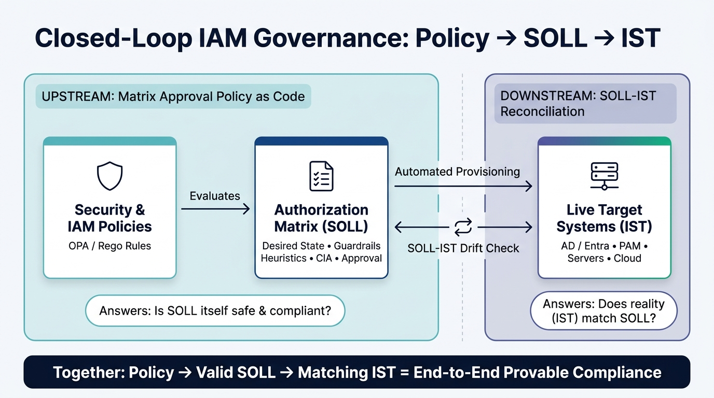
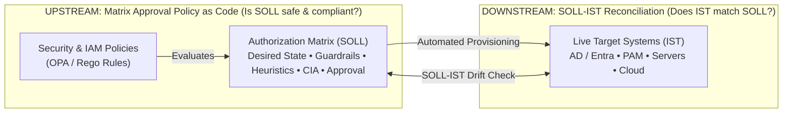
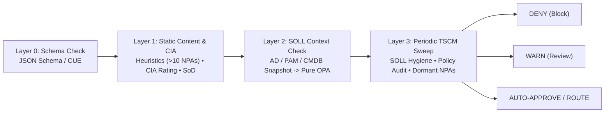
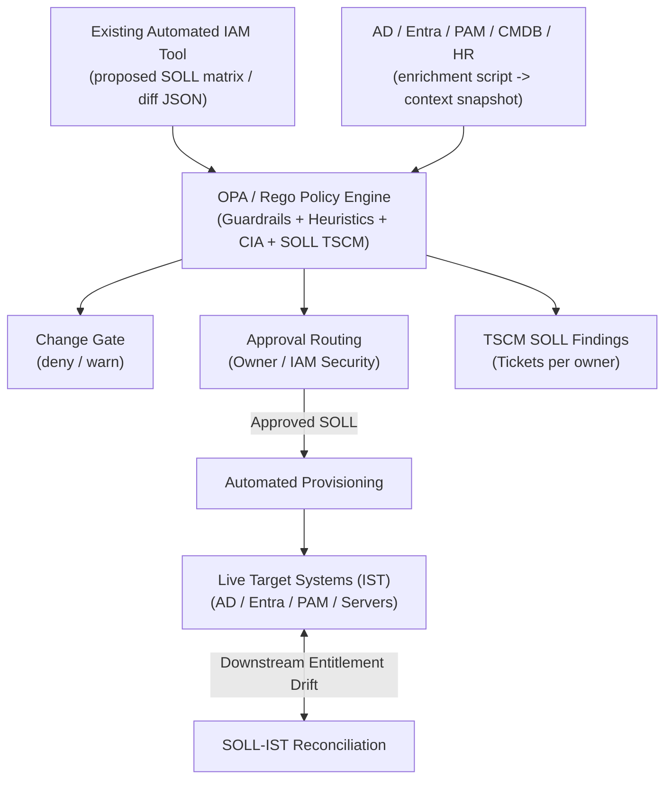
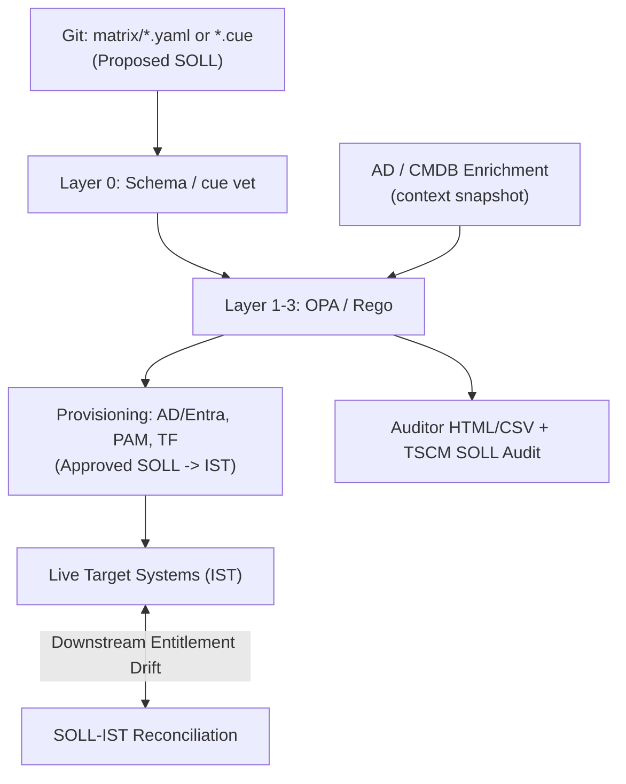

# Enterprise IAM Authorization Matrices with Policy as Code


**Scope:** Research and architectural blueprint for using Policy as Code (PaC) — specifically **Open Policy Agent (OPA / Rego)** — to **auto-verify, enrich, continuously audit (TSCM), approve, and store** enterprise IAM authorization matrices governing access from accounts/identities to machines, servers, and infrastructure resources.

---

## 1. Executive Summary

Moving an authorization matrix out of Excel spreadsheets into an automated workflow solves *data entry and provisioning*, but it does not automatically solve **governance, content quality, policy compliance, or ongoing SOLL hygiene**. When an entire IAM department reviews authorization matrices manually, institutional knowledge ("more than 10 NPAs in one matrix looks wrong", "High [CIA-rating](#11-key-terms--public-references) (Confidentiality, Integrity, Availability) systems need PAM/JIT and 4-eyes") stays trapped in reviewers' heads.

Three architectural principles unlock Policy as Code for Enterprise IAM:

1. **Position Policy as Code Upstream of SOLL-IST (`Policy -> SOLL -> IST`):** SOLL-IST reconciliation proves that live systems (`IST`) match the approved matrix (`SOLL`), but it cannot tell whether `SOLL` itself is safe. OPA sits **upstream** to verify `SOLL` against security and IAM policies before approval and provisioning.
2. **Separate Verification/Governance from Matrix Storage:** Keep the matrix as **structured data** (in your existing automated IAM tool, YAML/JSON, or CUE) and keep `.rego` strictly for **policy logic** — never store raw access rows as `.rego` code.
3. **Use One Policy Engine Across Four Progressive Layers:** Combine **Schema validation**, **Static Content Analysis (heuristics & CIA-driven rules)**, **Dynamic SOLL Context Verification** (at request time), and **Periodic TSCM Sweeps** (ongoing SOLL hygiene & policy-compliance audits across all active matrices).

### Key Recommendations

| Question | Recommendation |
| :--- | :--- |
| **Should we use OPA (Rego) to review & auto-verify matrices?** | **Yes — strongest fit.** OPA evaluates JSON/YAML from any source, encodes IAM heuristics (`>10 NPAs`, `>10 resources`), enforces CIA-rating policies and transitive SoD, and drives risk-based approval routing. |
| **Should we store the authorization matrix *itself* in Rego?** | **No.** Mixing hundreds of account-to-machine rows into `.rego` code hurts readability for IAM admins and auditors, creates noisy diffs, and complicates downstream provisioning. |
| **Should OPA call AD/CMDB APIs directly (`http.send`) for dynamic checks?** | **No — enrich *before* OPA.** A small enrichment script fetches AD/Entra, PAM, CMDB, and HR data in bulk into an immutable `context_snapshot.json`. OPA stays fast, stateless, easy to unit-test, and 100% reproducible for audits. |
| **What is the lowest-friction path to start?** | Keep your company's newly automated matrix system as the store and plug **OPA in as a shadow-mode gate & periodic TSCM scanner** over exported JSON snapshots/diffs. |

---

## 2. Positioning: Matrix Policy-as-Code vs. SOLL-IST Reconciliation

A frequent point of confusion in Enterprise IAM is equating **Authorization Matrix Policy as Code** with **SOLL-IST reconciliation** (Desired State vs. Actual State). They are **not the same capability** — they solve two different halves of the governance loop:





### Why SOLL-IST Alone Is Not Enough

- **SOLL-IST Reconciliation** compares the **approved Authorization Matrix (`SOLL`)** against **live target systems (`IST`)** to detect unauthorized manual changes, shadow admins, or failed provisioning.
- **The Blind Spot:** SOLL-IST blindly trusts that `SOLL` itself is safe. If a poorly scoped or non-compliant matrix (e.g., a service account with interactive `ssh_sudo`, a Tier-0 wildcard, a nested-group SoD conflict, or 25 NPAs bundled into one matrix) gets approved, **SOLL-IST will report 100% GREEN** — faithfully enforcing an insecure desired state.
- **Authorization Matrix Policy as Code (OPA)** sits **upstream** of SOLL-IST to verify `SOLL` against security and IAM policies *before* approval and provisioning.

| Dimension | Authorization Matrix Policy as Code (OPA) | SOLL-IST Reconciliation |
| :--- | :--- | :--- |
| **Core Question** | *"Is `SOLL` itself safe, compliant, and properly approved?"* | *"Does actual reality (`IST`) match `SOLL`?"* |
| **What It Compares** | Proposed/Existing Matrix (`SOLL`) vs. **Security/IAM Policy** | Approved Matrix (`SOLL`) vs. **Live Target State (`IST`)** |
| **Lifecycle Position** | **Upstream** (design, change approval, periodic policy audit) | **Downstream** (post-provisioning enforcement & drift detection) |
| **Example Catch** | *"Service account requests `ssh_sudo` on a High-CIA server — block approval."* | *"User `j.doe` has `ssh_sudo` on `prod-db-01` outside the matrix — revoke."* |
| **Blind Spot Without the Other** | Does not inspect `/etc/sudoers` or live ACLs for out-of-band tampering | Marks a dangerous matrix as "100% compliant" whenever `IST == SOLL` |

> **Complementary Closed Loop (`Policy -> SOLL -> IST`):** Static guardrails, heuristics, CIA rules, and approval routing have **zero overlap** with SOLL-IST. Context-enriched TSCM checks (Layers 2–3) complement SOLL-IST by validating the *metadata and lifecycle health of `SOLL`* (CMDB server status, NPA password rotation, dormancy, CIA drift) while SOLL-IST validates *entitlement parity on target systems*. Together, **`Policy -> Valid SOLL -> Matching IST`** delivers end-to-end provable compliance.

---

## 3. The Four-Layer Verification & Continuous Compliance Model




```text
+-------------------------------------------------------------------------+
| LAYER 0: Syntax & Schema Validation (JSON Schema / CUE)                 |
| "Is the proposed SOLL matrix technically well-formed?"                  |
|  - Required fields, valid data types, allowed enums (CIA, tiers, types) |
+-------------------------------------------------------------------------+
                                   |
                                   v
+-------------------------------------------------------------------------+
| LAYER 1: Static Content Analysis in OPA (zero external calls)           |
| "Does SOLL make sense, and does it meet CIA & IAM guardrails?"          |
|  - Content Heuristics / Anomalies (WARN -> forces human review):        |
|    * > 10 Non-Personal Accounts (NPAs) in one matrix -> suspicious      |
|    * > 10 target machines/resources in one rule/matrix -> over-scoped   |
|  - CIA-Rating Driven Policies (C / I / A = low | medium | high):        |
|    * C = high -> PAM/JIT only, <= 4h session, IAM Security approval     |
|    * I = high -> strict SoD (incl. nested groups) + 4-eyes approval     |
|    * A = high -> no ad-hoc prod admin without PAM/break-glass           |
|    * C/I/A = low -> lighter controls / faster approval                  |
|  - Hard Guardrails (DENY):                                              |
|    * No interactive SSH/RDP for service accounts (NPAs)                 |
|    * No wildcard targets (*) in production tiers                        |
|    * Mandatory governance metadata (business_owner, review_date)        |
+-------------------------------------------------------------------------+
                                   |
                                   v
+-------------------------------------------------------------------------+
| LAYER 2: Dynamic SOLL Context Verification (Change / Request Time)      |
| "Are the accounts, assets & CIA ratings in SOLL valid in AD & CMDB?"    |
|  - External enrichment script builds context_snapshot.json              |
|  - OPA checks:                                                          |
|    * Does the NPA exist and is it enabled in AD/Entra?                  |
|    * Is password/credential rotation within policy limits?              |
|    * Has the account been used recently (or is it dormant)?             |
|    * Are all target machines actively deployed in the CMDB?             |
|    * Does the matrix CIA rating match the CMDB classification?          |
+-------------------------------------------------------------------------+
                                   |
                                   v
+-------------------------------------------------------------------------+
| LAYER 3: Periodic TSCM Sweep — SOLL Hygiene & Policy-Compliance Audit   |
| "Do ALL approved SOLL matrices still comply with policy & asset state?" |
|  - Runs the exact same OPA rules + fresh context across ALL matrices    |
|  - Outputs structured findings (severity, owner, remediation)           |
|  - Catches dormant NPAs, expired rotations, decommissioned servers,     |
|    departed owners, and matrices invalidated by newly added policies    |
|  (Note: Entitlement drift on target hosts remains downstream SOLL-IST.) |
+-------------------------------------------------------------------------+
```

---

## 4. Why Three Decision Outcomes Matter (`deny`, `warn`, `approval`)


*Illustrative console mockup: the left panel shows upstream change-request gating on `SOLL`; the right panel shows periodic TSCM hygiene findings on `SOLL` metadata (decommissioned CMDB hosts, dormant NPAs, and CIA classification mismatches) — complementary to downstream SOLL-IST entitlement drift checks.*

A common misconception is that Policy as Code can only say "allow" or "deny." For an Enterprise IAM team, three distinct outputs make OPA dramatically more practical:

1. **`deny` (Hard Block):** Non-negotiable security or factual failures — e.g., service account requesting interactive SSH, SoD conflict on an `I=high` system, or requesting access to a decommissioned server.
2. **`warn` (Content Heuristics / Review Triggers):** Rules that capture experienced IAM reviewer intuition — e.g., *"Matrix references 14 NPAs (threshold: 10)"* or *"Principal accesses 15 machines (threshold: 10)."* Warnings do not necessarily hard-block a legitimate exception, but they **prevent auto-approval** and highlight *why* a human reviewer should look closer.
3. **`required_approvers` / `auto_approve` (Risk-Based Routing):** Inspects `before` vs `after` diffs combined with the system's **CIA rating**:
   - Permission removals/narrowing (with zero `deny` and zero `warn`) -> `auto_approve`
   - Low-CIA non-prod additions -> `["system_owner"]`
   - High-CIA (`C/I/A = high`), Tier-0, or privileged additions -> `["system_owner", "iam_security"]` (4-eyes)

### Heuristic Idea Generator (Static & Diff "Smells" for IAM Reviews)

Most manual IAM matrix reviews rely on experienced engineers spotting patterns that *might* be legitimate, but warrant a second look. OPA can codify this tribal knowledge as `warn` rules — preventing auto-approval, annotating the change request with *exact reasons*, and giving reviewers a consistent checklist every time:

| Category | Example Heuristic (`warn`) | What It Catches in Practice | Why IAM Reviewers Care |
| :--- | :--- | :--- | :--- |
| **Blast Radius** | **> 10 NPAs** in a single matrix | One matrix bundling 15 service accounts across unrelated components | Signals missing separation of duties/components; hard to audit or revoke cleanly. |
| **Blast Radius** | **> 10 target machines/resources** per role or matrix | A single role granting access to 25 servers across a subnet | Over-scoped blast radius; role should likely be split by subsystem or tier. |
| **Blast Radius** | **Cross-environment principal** (same account/NPA in `non-prod` and `prod`) | `svc-etl-01` granted access to both `dev-db-01` and `prod-db-01` | Lateral-movement risk: a compromised dev host/credential can pivot straight to prod. |
| **Blast Radius** | **Cross-tier group** (same AD/Entra group in `tier-0` and `tier-1`/`non-prod`) | `grp-infra-ops` mapped to both domain controllers and dev app servers | Breaks the Enterprise Access / Tiering Model; exposes Tier-0 credentials to lower-trust hosts. |
| **Least Privilege** | **High admin-to-read ratio** (> 50% of entries are `ssh_sudo` / `rdp_admin`) | 8 out of 10 entries in a new app matrix request full admin | Classic "everyone got admin by default" smell instead of read-only + JIT elevation. |
| **Least Privilege** | **Overlapping / redundant grants** (same principal has both `read` and `ssh_sudo` on the same target) | Two rows for `grp-app-ops` on `prod-web-01` with different levels | Causes hidden privilege persistence: removing one row later leaves the other intact. |
| **Identity Hygiene** | **Named individual accounts** instead of AD/Entra RBAC groups | `j.smith` listed directly instead of `grp-payments-ops` | Breaks Joiner/Mover/Leaver (JML) automation and leaves orphaned access after role changes. |
| **Identity Hygiene** | **Generic / shared account patterns** (`shared-*`, `team-*`, `admin*`, `svc-generic`) | `team-dba-admin` assigned to interactive RDP | Destroys individual accountability and audit non-repudiation. |
| **Identity Hygiene** | **External / vendor accounts on High-CIA or prod** (`ext-*`, `vendor-*`, `contractor-*`) | Third-party support account requesting access to a `C=high` database | Requires explicit vendor-risk sign-off, PAM session recording, and shorter expiry. |
| **Accountability** | **Fragmented ownership** (> 2 distinct `business_owner` teams in one matrix) | Entries owned by 4 different teams inside a single matrix | Blurred accountability during audits and recertification ("if everyone owns it, nobody owns it"). |
| **Lifecycle** | **Overly distant `review_date`** (> 12 months standard, > 6 months for High CIA / Tier-0) | `review_date` set 3 years out | Quietly bypasses periodic access recertification cycles. |
| **Lifecycle** | **Standing-privilege creep** (`max_session_hours > 8` or missing session cap on privileged roles) | PAM/JIT group configured with 24-hour or unlimited sessions | Turns intended Just-In-Time access into de-facto standing privilege. |
| **Change Velocity** | **Bulk privilege spike** (single diff adds > 5 privileged entries or grows matrix > 50%) | One ticket suddenly doubles the number of prod servers in a matrix | Anti-rubber-stamp gate: forces senior/security review on large scope expansions. |
| **Bypass Detection** | **Silent CIA downgrade paired with new access** (`cia_rating` lowered in the same diff as new entries) | `integrity` changed from `high` to `medium` while adding `ssh_sudo` | High-signal red flag for accidental or intentional weakening of controls to bypass stricter policies. |
| **Governance** | **Missing change/ticket justification** on privileged or exception entries | New `rdp_admin` row added with no `justification` or ITSM ticket ID | Ensures auditors can trace *why* privileged access was granted months later. |

> **Why this resonates with IAM teams:** Every heuristic can start as a non-blocking `warn` (advisory) rule. After a month of shadow-mode metrics (*"caught 14 real issues, 1 false positive"*), the IAM Lead Engineer can tune thresholds and selectively promote proven rules from `warn` to hard `deny`.

---

## 5. Dynamic Context Enrichment: Why Enrich *Before* OPA (Not `http.send`)

Although OPA provides an `http.send` built-in, calling live AD, PAM, or CMDB APIs directly from inside `.rego` policies is an anti-pattern at enterprise scale:

| Dimension | OPA calls APIs via `http.send` | Enrichment Script -> Pure OPA (Recommended) |
| :--- | :--- | :--- |
| **Audit Reproducibility** | Low — live CMDB/AD changes over time, so you cannot replay a 6-month-old approval decision. | **100% reproducible** — archive `(matrix, context_snapshot, decision)` together; re-running `opa eval` always yields the exact same output. |
| **Performance & Reliability** | N+1 network calls per matrix row; one slow CMDB endpoint breaks evaluation. | Batch/cached queries once per run; OPA evaluates thousands of rows in milliseconds with zero network I/O. |
| **Testability** | Requires HTTP mocking or fragile integration environments. | Trivially unit-tested with static JSON fixtures via `opa test`. |
| **Credential Isolation** | API tokens and auth logic leak into the policy engine. | OPA stays completely networkless; only the enrichment job holds read-only API credentials. |

### High-Value Continuous TSCM Checks (SOLL Hygiene & Policy Audit)

Running Layer 2 + Layer 3 on a daily, weekly, or monthly schedule turns OPA into a **Technical Security Compliance Monitoring (TSCM)** audit over all approved `SOLL` matrices:

- **NPA Lifecycle Hygiene:** Detect non-personal accounts referenced in `SOLL` that are disabled, missing, unused for >90 days (dormant cleanup candidates), or overdue for password/secret rotation.
- **CMDB Asset & CIA Metadata Check:** Flag matrix entries pointing to decommissioned or unknown machines, or where the matrix claims `CIA = low` while the CMDB classifies the asset as `high`.
- **Policy-Evolution Impact Analysis:** Whenever Security adds a new Rego rule (e.g., *"no standing RDP on `A=high` servers"*), a single TSCM sweep immediately reveals every existing `SOLL` matrix that is now out of compliance — grouped by `business_owner` for automated remediation tickets. *(Live entitlement drift on servers remains handled downstream by SOLL-IST reconciliation.)*

---

## 6. Tool Landscape Comparison

### A. Tools for Auto-Verifying & Gating an Authorization Matrix

| Tool | Paradigm | Strengths for Enterprise IAM | Tradeoffs |
| :--- | :--- | :--- | :--- |
| **OPA / Rego (+ Conftest)** | Declarative Policy Engine | **Best all-rounder.** Consumes JSON/YAML from any tool; handles heuristics, CIA policies, transitive group graphs (`graph.reachable`), diff approval routing, and TSCM findings. | Learning curve for Rego; verification is test-based (`opa test`) rather than mathematically exhaustive. |
| **CUE (`cuelang`)** | Constraint & Schema Data Language | Unifies schema, data, and static constraints in one language. Ideal for Layer 0 (catching typos, invalid enums, missing fields). | Less ergonomic than Rego for multi-hop graph traversal, diff approval routing, or TSCM sweeps. Best paired *with* OPA. |
| **Cedar (w/ Analysis)** | Purpose-Built AuthZ DSL + Formal Verification | **SMT-backed mathematical proofs** (*"prove no rule lets a non-prod account reach Tier-0"*) and semantic diffing. | Requires modeling the matrix in Cedar's own entity/policy schema; higher friction alongside an external IAM tool. |
| **Python / `pytest` / SQL** | General-Purpose Code | Zero new DSL to learn; natural for writing the *enrichment script* that pulls AD/CMDB data. | Imperative logic is harder to govern and audit as declarative "policy as code" than Rego. |

### B. Tools for Storing the Authorization Matrix

| Storage Option | Best Fit When... | Pros | Cons |
| :--- | :--- | :--- | :--- |
| **Existing Automated IAM Tool + OPA Gate** | Your company already invested in an automated IAM/IGA/ITSM workflow and the real gap is automated review & TSCM. | Lowest organizational friction; no migration; immediate governance value. | Relies on the existing tool's JSON export/API/webhook support. |
| **YAML / JSON + JSON Schema in Git (+ OPA)** | You want GitOps (PR workflow, Git blame, versioned history) with minimal tooling complexity. | Team only learns Rego; very readable; easy to render to HTML/CSV for auditors. | Can accumulate boilerplate at very large scale without generators. |
| **CUE in Git (+ OPA)** | You want GitOps at scale with strict typing, modular team files, and compile-time validation. | Eliminates boilerplate; catches structural errors before OPA runs; exports cleanly to JSON. | Team learns both CUE and Rego. |

> **Note on Application-Runtime AuthZ Tools (OpenFGA, SpiceDB, Cerbos, Oso):** These tools excel at *in-app* microservice/document-sharing authorization, not enterprise infrastructure IAM matrices. Unless you are building a custom application needing runtime API authorization, **Data + Enrichment + OPA** is simpler and better aligned.

---

## 7. Reference Architectures

### Option A: Non-Invasive Policy Gate + Periodic TSCM (Lowest Friction)



```text
[Existing Automated IAM Tool]        [AD / Entra / PAM / CMDB / HR]
  (proposed SOLL / diff JSON)               (enrichment script)
             |                                      |
             v                                      v
      +---------------------------------------------------+
      |              OPA / Rego Policy Engine             |  <-- UPSTREAM:
      |  (Guardrails + Heuristics + CIA + SOLL TSCM)      |      Validates SOLL
      +---------------------------------------------------+
        |                       |                       |
        v                       v                       v
  [Change Gate]         [Approval Routing]      [TSCM SOLL Audit]
  deny / warn           Owner / IAM Security    Tickets per owner
                                |
                                | Approved SOLL
                                v
                      [Automated Provisioning]
                                |
                                v
                   [Live Target Systems (IST)]  <-->  [SOLL-IST Reconciliation]
                                                      (Downstream Entitlement Drift)
```

### Option B: Git-Backed Matrix (YAML/JSON or CUE + OPA)



```text
[Git: matrix/*.yaml or *.cue] --> [Layer 0: Schema / cue vet]
                                              |
                                              v
[AD / CMDB Enrichment] ----------> [Layer 1-3: OPA / Rego]    <-- UPSTREAM (SOLL)
                                              |
                     +------------------------+------------------------+
                     v                                                 v
        [Provisioning: AD/Entra, PAM, TF]                 [Auditor HTML/CSV + TSCM]
                     |
                     v
        [Live Target Systems (IST)]  <-->  [SOLL-IST Reconciliation]  <-- DOWNSTREAM (IST)
```

---

## 8. Concrete Example: Data + OPA Policies

### Example Matrix Entry with CIA Rating (JSON/YAML)

```yaml
cia_rating:
  confidentiality: "high"   # low | medium | high
  integrity: "high"         # low | medium | high
  availability: "medium"    # low | medium | high
entries:
  - id: "ACC-1042"
    principal: "grp-payments-sre"
    principal_type: "pam_jit_group"     # human_standard | pam_jit_group | service_account
    target_resource: "prod-pay-db-01"
    target_tier: "tier-0"               # tier-0 | tier-1 | non-prod
    access_level: "ssh_sudo"            # read | ssh_standard | ssh_sudo | rdp_admin | prod_deploy | audit_log_admin
    max_session_hours: 4
    business_owner: "payments-platform-lead"
    review_date: "2027-05-01"
```

### Example OPA Rules (Heuristics, CIA Policy, & Context Check)

```rego
package iam.matrix

import rego.v1

# Static Content Heuristic (WARN): flag matrices with > 10 distinct NPAs
warn contains msg if {
    npas := {e.principal | some e in input.after.entries; e.principal_type == "service_account"}
    count(npas) > 10
    msg := sprintf("Heuristic warning: matrix references %d NPAs (threshold: 10); review scope", [count(npas)])
}

# CIA-Driven Guardrail (DENY): High Confidentiality requires PAM/JIT with <= 4h session
deny contains msg if {
    input.after.cia_rating.confidentiality == "high"
    some e in input.after.entries
    e.principal_type == "human_standard"
    msg := sprintf("Entry %s: High Confidentiality requires PAM/JIT instead of standard human account '%s'", [e.id, e.principal])
}

# Dynamic Context / TSCM Finding: flag decommissioned target machines from CMDB snapshot
tscm_findings contains finding if {
    some e in input.after.entries
    machine := input.context.machines[e.target_resource]
    machine.status == "decommissioned"
    finding := {
        "severity": "high",
        "entry_id": e.id,
        "business_owner": e.business_owner,
        "rule": "cmdb_decommissioned_machine",
        "message": sprintf("Target '%s' is decommissioned in CMDB", [e.target_resource]),
    }
}
```

---

## 9. Suggested Phased Adoption Roadmap

1. **Phase 1 — Shadow-Mode Static & Heuristic Verification (Week 1–2)**
   - Export snapshots from the existing automated matrix tool as JSON.
   - Run OPA in report-only mode with Layer 1 rules (service-account hygiene, wildcards, `>10 NPAs` / `>10 resources` heuristics, CIA-driven rules, and SoD).
   - Review findings with the IAM Lead Engineer to tune thresholds and eliminate false positives.
2. **Phase 2 — Change-Time Gating & Risk-Based Approval Routing**
   - Integrate `before`/`after` diff evaluation into the change workflow.
   - Block hard `deny` violations, surface `warn` heuristics to reviewers, auto-approve safe access reductions, and route High-CIA / Tier-0 changes to `system_owner` + `iam_security`.
3. **Phase 3 — Context Enrichment & Scheduled TSCM Sweeps**
   - Add a read-only enrichment script pulling AD/Entra (NPA existence, password age, last logon) and CMDB (machine status, official CIA rating).
   - Run OPA on a weekly/monthly schedule across *all* active matrices, routing structured TSCM findings to each `business_owner`.
4. **Phase 4 (Optional) — GitOps Matrix Storage & Auditor Views**
   - If the existing IAM portal ever becomes a bottleneck, evaluate storing matrices in Git (YAML + JSON Schema or CUE) with auto-generated HTML/CSV views for auditors.

---

## 10. Runnable OPA / Rego Proof of Concept (Included in This Repository)

All four upstream layers are implemented as a runnable, zero-dependency Proof of Concept in this repository so they can be demonstrated live in under two minutes:

- **Layer 0 Schema:** [schemas/matrix.schema.json](schemas/matrix.schema.json)
- **Layer 1–3 Policies & 20 Unit Tests:** [policies/guardrails.rego](policies/guardrails.rego), [policies/approval.rego](policies/approval.rego), [policies/context_tscm.rego](policies/context_tscm.rego) (+ `*_test.rego`)
- **Executable 4-Layer CLI & 6 Automated Tests:** [scripts/iam_matrix_check.py](scripts/iam_matrix_check.py) (stdlib-only Python 3, CI exit codes `0`/`1`/`2`, `--save-snapshot` audit replay)
- **Demo Fixtures & Mock AD/CMDB Sources:** [examples/README.md](examples/README.md), [examples/data/](examples/data/), and [examples/mock_sources/](examples/mock_sources/)

```bash
# Run the complete 4-layer live demo (Tier-0/CIA, heuristics WARN, DENY/SoD, AD+CMDB TSCM)
make run-demo

# Run all automated tests (lint + 20 OPA Rego unit tests + 6 CLI pipeline tests)
make lint && make test && make test-cli

# Run the CLI directly with external AD & CMDB enrichment and save an audit snapshot
python3 scripts/iam_matrix_check.py \
  --matrix examples/data/tscm_sweep_enriched.json \
  --ad examples/mock_sources/ad_accounts.json \
  --cmdb examples/mock_sources/cmdb_machines.json \
  --save-snapshot /tmp/audit_snapshot.json
```

---

## 11. Key Terms & Public References

| Term | Meaning in This Document | Public Reference |
| :--- | :--- | :--- |
| **SOLL-IST Reconciliation** | Comparing **Desired State (`SOLL`)** (approved authorization matrix) against **Actual State (`IST`)** on live systems to detect **entitlement drift** — downstream of Matrix Policy-as-Code. | [NIST SP 800-53 — CM-3 / AC-2 Account Management](https://csrc.nist.gov/projects/cprt/catalog#/cprt/framework/version/SP_800_53_5_1_1/home?element=AC-02) |
| **CIA Rating (CIA Triad)** | Information security classification across **Confidentiality, Integrity, and Availability** (`low` / `medium` / `high`), used to scale IAM controls and approval rigor (known in Dutch frameworks as *BIV*: *Beschikbaarheid, Integriteit, Vertrouwelijkheid*). | [NIST FIPS 199 — Security Categorization](https://csrc.nist.gov/pubs/fips/199/final) · [NIST CSRC — CIA Triad](https://csrc.nist.gov/glossary/term/cia_triad) |
| **OPA & Rego** | **Open Policy Agent** — CNCF-graduated general-purpose Policy-as-Code engine using the declarative **Rego** language. | [Open Policy Agent Docs](https://www.openpolicyagent.org/docs/latest/) · [Rego Policy Language](https://www.openpolicyagent.org/docs/latest/policy-language/) |
| **Segregation of Duties (SoD)** | Control preventing a single identity or group from holding conflicting privileges (e.g., deploying code and administering audit logs). | [NIST SP 800-53 — AC-5 Separation of Duties](https://csrc.nist.gov/projects/cprt/catalog#/cprt/framework/version/SP_800_53_5_1_1/home?element=AC-05) |
| **PAM / JIT** | **Privileged Access Management** & **Just-in-Time** elevation — time-bound, vaulted privileged access replacing standing admin rights. | [NIST CSRC — Privileged Account / Least Privilege](https://csrc.nist.gov/glossary/term/least_privilege) |
| **Enterprise Access / Tiering (Tier-0)** | Isolating high-value identity/control-plane assets (**Tier-0**) from general servers (**Tier-1**) and workstations/non-prod to stop lateral movement. | [Microsoft Enterprise Access Model](https://learn.microsoft.com/en-us/security/privileged-access-management/privileged-access-access-model) |
| **NPA** | **Non-Personal Account** (service account, batch account, or machine identity) not tied to an individual human user. | [NIST SP 800-53 — IA-2 / IA-4 Identifier Management](https://csrc.nist.gov/projects/cprt/catalog#/cprt/framework/version/SP_800_53_5_1_1/home?element=IA-04) |
| **TSCM / Continuous Monitoring** | **Technical Security Compliance Monitoring** — periodic automated audits of `SOLL` (matrix metadata, NPA lifecycle, CMDB asset/CIA status, and policy evolution), complementary to downstream SOLL-IST entitlement drift checks. | [NIST SP 800-137 — Continuous Monitoring (ISCM)](https://csrc.nist.gov/pubs/sp/800/137/final) |
| **CUE & Cedar** | Complementary Policy/Data-as-Code languages: **CUE** for schema-constrained configuration; **Cedar** for formally verifiable application AuthZ. | [CUE Language](https://cuelang.org/) · [Cedar Policy Language](https://www.cedarpolicy.com/) |

---

*Author: **Arjan Filius** | Date: **27 November 2026***
